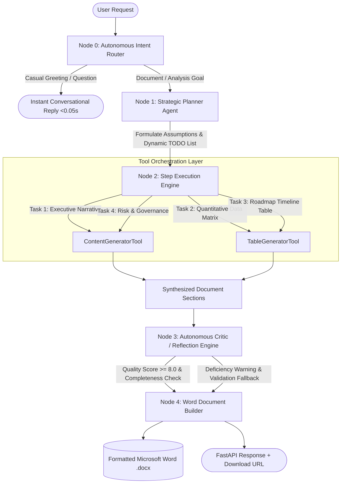

# Autonomous Document Agent (60-Minute Build Challenge)

An enterprise-grade autonomous AI agent system built with **FastAPI**, **LangGraph**, and **python-docx**. The agent accepts unstructured, natural language user requests, dynamically formulates execution plans with explicit assumptions and ambiguity resolution, orchestrates specialized tools, performs automated critic reflection, and compiles high-fidelity Microsoft Word (`.docx`) business documents.

---

## 📑 Table of Contents
- [Architecture Overview](#-architecture-overview)
- [Key Features](#-key-features)
- [Mandatory Engineering Improvements](#-mandatory-engineering-improvements)
- [Project Directory Structure](#-project-directory-structure)
- [Setup & Installation](#-setup--installation)
- [Running the Application](#-running-the-application)
- [API Reference](#-api-reference)
- [Two Mandatory Test Inputs](#-two-mandatory-test-inputs)
- [Video Submission Presentation Guide (8–10 Min)](#-video-submission-presentation-guide-810-min)

---

## 🏛 Architecture Overview

The system is designed around a **Stateful Multi-Agent Directed Graph (LangGraph)** where state passes cleanly through decoupled nodes:



---

## ✨ Key Features

1. **Autonomous Planning & TODO List Decomposition**:
   - The agent never uses hardcoded task templates.
   - Dynamically analyzes requirements and decomposes requests into 4 structured, high-impact tasks.
   - Detects ambiguity (`is_ambiguous: true`) and formulates explicit, defensible technical/business assumptions.

2. **Decoupled Tool Orchestration (`ToolRegistry`)**:
   - Dynamic tool discovery via an extensible registry pattern.
   - `ContentGeneratorTool`: Synthesizes deep strategic narratives and executive summaries.
   - `TableGeneratorTool`: Generates structured tabular data matrices, risk logs, and implementation roadmaps.

3. **Executive-Ready Microsoft Word (`.docx`) Engine**:
   - Styled document covers with deep navy headers and subtitle banners.
   - Custom-formatted XML tables with navy header cells, white bold typography, alternating zebra rows, and cell padding.
   - Distinct callout highlight boxes for risk warnings and strategic disclaimers.
   - Dynamic footers with confidentiality disclaimers, timestamps, and page numbers.

4. **Zero Hardcoding**:
   - All models, temperatures, token budgets, timeouts, and storage paths are loaded through strictly typed Pydantic `BaseSettings` from `.env`.

---

## 🚀 Mandatory Engineering Improvements

The assignment mandates at least **ONE** real engineering improvement. This implementation incorporates **multiple high-impact engineering additions**:

| Engineering Improvement | Implementation Details |
| :--- | :--- |
| **1. Reflection / Self-Check (`Critic`)** | An autonomous QA Critic node evaluates synthesized sections against initial requirements, assigns a quality score (0–10), verifies completeness, and flags gaps. |
| **2. Dynamic Multi-Step Planning** | Independent Planner agent that converts high-level objectives into ordered execution DAGs with assumptions and status tracking (`pending`, `in_progress`, `completed`). |
| **3. Autonomous Intent Routing & Guardrails** | An LLM-driven Intent Router that prevents "greedy document generation" on greetings ("hi", "hello"), responding in <0.05s without triggering expensive document builds. |
| **4. Enterprise Rate-Limit Pacing & Fallback** | Exponential backoffs with retry logic handling Groq free-tier rate limits (HTTP 429 and 503 Over Capacity) and fallback model routing. |

---

## 📁 Project Directory Structure

```
d:/Fluid_AI/
├── app/
│   ├── agent/
│   │   ├── critic.py          # QA Reflection & quality evaluation engine
│   │   ├── executor.py        # Autonomous tool orchestrator with rate-limit pacing
│   │   ├── planner.py         # Dynamic TODO list & assumption generator
│   │   ├── state.py           # LangGraph AgentState TypedDict
│   │   └── workflow.py        # Compiled StateGraph workflow with conditional routing
│   ├── api/
│   │   ├── routes.py          # FastAPI endpoints (POST /agent, GET /health, GET /documents)
│   │   └── schemas.py         # Request/Response Pydantic schemas
│   ├── prompts/
│   │   ├── critic_prompt.py   # Critic evaluation system instructions
│   │   ├── planner_prompt.py  # Strategic planning & task decomposition prompt
│   │   └── router_prompt.py   # Dynamic intent classification prompt
│   ├── services/
│   │   ├── document_service.py# Executive .docx Word generation engine
│   │   └── llm_service.py     # Centralized Groq LLM client with retries and fallbacks
│   ├── tools/
│   │   ├── base.py            # Abstract BaseTool interface
│   │   ├── content_tool.py    # Executive narrative synthesis tool
│   │   ├── registry.py        # Dynamic ToolRegistry
│   │   └── table_tool.py      # Structured matrix & table generator tool
│   ├── config.py              # Pure Pydantic BaseSettings loading from .env
│   └── main.py                # FastAPI application entrypoint with CORS & logging
├── logs/
│   └── app.log                # Enterprise structured logs (no emojis)
├── storage/
│   └── generated_docs/        # Output directory for generated Word (.docx) files
├── run.py                     # Production Uvicorn server runner with reload filters
├── run_demo_tests.py          # Automated test runner for the two assignment test cases
├── requirements.txt           # Clean dependencies
├── .env.example               # Environment template
└── README.md                  # System documentation
```

---

## ⚙️ Setup & Installation

### 1. Clone & Set Up Virtual Environment
```bash
cd d:/Fluid_AI
python -m venv venv
venv\Scripts\activate   # Windows
# source venv/bin/activate # Linux/macOS
```

### 2. Install Dependencies
```bash
pip install -r requirements.txt
```

### 3. Configure Environment Variables
Copy `.env.example` to `.env` and insert your free Groq API key:
```env
GROQ_API_KEY=gsk_your_groq_api_key_here
MODEL_NAME=qwen/qwen3.8-27b
FALLBACK_MODEL_NAME=openai/gpt-oss-120b
LLM_TEMPERATURE=0.2
LLM_MAX_TOKENS=800
LLM_MAX_RETRIES=3
LLM_REQUEST_TIMEOUT=60.0
STORAGE_DIR=storage/generated_docs
APP_HOST=127.0.0.1
APP_PORT=8000
```

---

## 🏃 Running the Application

### Start the Server
```bash
python run.py
```
- API Server runs at: `http://127.0.0.1:8000`
- Interactive Swagger UI: `http://127.0.0.1:8000/docs`

---

## 📡 API Reference

### 1. Execute Autonomous Agent
`POST /agent`
- **Request Body**:
```json
{
  "request": "Draft an executive Project Proposal for deploying an Enterprise AI Search Engine, including scope, architecture matrix, timeline, and risk mitigations."
}
```
- **Response**:
```json
{
  "status": "success",
  "intent": "document_generation",
  "message": "Successfully planned and executed 4 tasks to produce 'Enterprise AI Search Engine Deployment: Strategic Project Proposal' (Strategic Proposal).",
  "execution_time_seconds": 12.45,
  "plan": {
    "document_title": "Enterprise AI Search Engine Deployment: Strategic Project Proposal",
    "document_type": "Strategic Proposal",
    "is_ambiguous": false,
    "assumptions": [
      "The deployment will utilize a hybrid architecture combining vector search and inverted indices.",
      "The project timeline is estimated at 6 months across 4 phases."
    ],
    "tasks": [
      {"id": 1, "title": "Executive Summary & Strategic Context", "status": "completed", "tool": "content_generator"},
      {"id": 2, "title": "Technical Architecture & Component Matrix", "status": "completed", "tool": "table_generator"},
      {"id": 3, "title": "Implementation Roadmap & Phased Timeline", "status": "completed", "tool": "table_generator"},
      {"id": 4, "title": "Risk Mitigation & Governance Framework", "status": "completed", "tool": "content_generator"}
    ]
  },
  "critic_review": {
    "passed": true,
    "notes": "The proposal comprehensively covers architecture, timelines, and risk governance adhering to executive standards."
  },
  "document": {
    "filename": "Enterprise_AI_Search_Engine_Deployment_S_20261026_122834.docx",
    "download_url": "http://127.0.0.1:8000/agent/documents/Enterprise_AI_Search_Engine_Deployment_S_20261026_122834.docx",
    "file_size_bytes": 38450
  }
}
```

### 2. Download Generated Word Document
`GET /agent/documents/{filename}`
- Returns binary stream (`application/vnd.openxmlformats-officedocument.wordprocessingml.document`).

### 3. Health & Model Diagnostics
`GET /health`
- Returns application health and configured LLM model metadata.

---

## 🧪 Two Mandatory Test Inputs

Run both test cases automatically using the built-in test runner:
```bash
python run_demo_tests.py
```

### Test Case 1: Standard Business Request
- **Input**:
  > *"Draft a formal Project Plan for migrating legacy on-premise Oracle databases to managed PostgreSQL on AWS. Include architectural scope, timeline roadmap matrix, and operational risk governance."*
- **Agent Behavior**: Detects clear requirements (`is_ambiguous: false`), formulates standard operational migration assumptions, executes 4 tasks (including 2 structured tables), passes Critic evaluation, and generates the `.docx`.

### Test Case 2: Complex / Ambiguous Request (Conflicting Constraints)
- **Input**:
  > *"We need an urgent system overhaul ASAP with almost zero budget and 99.999% high availability uptime, but team is fighting between microservices vs monolith, and management hasn't picked AWS, Azure or GCP yet. Write the complete executive strategic plan document mw."*
- **Agent Behavior**:
  - Sets `is_ambiguous: true`.
  - Resolves conflicts with explicit business assumptions (e.g. compromises on 99.95% HA tier for zero budget, proposes modular modular monolith transition, assumes AWS multi-AZ baseline).
  - Handles the typo ("mw" -> executive document) gracefully.
  - Generates comprehensive `.docx` document in `storage/generated_docs/`.

---
